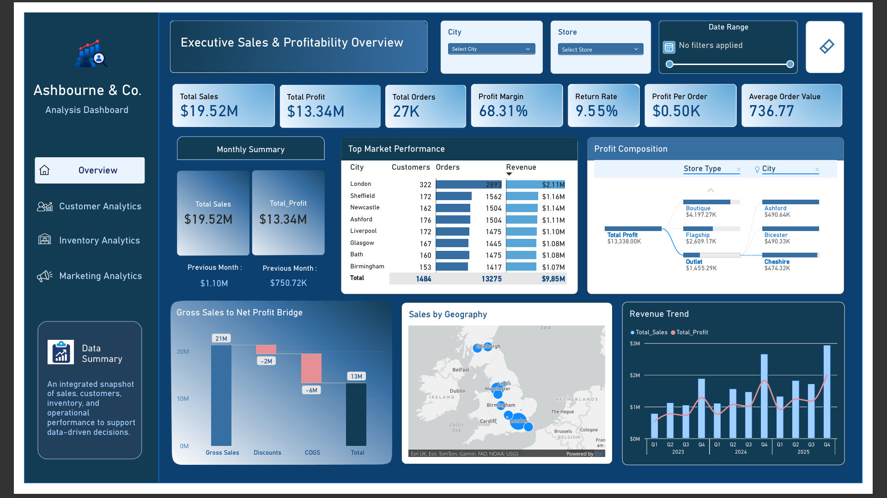
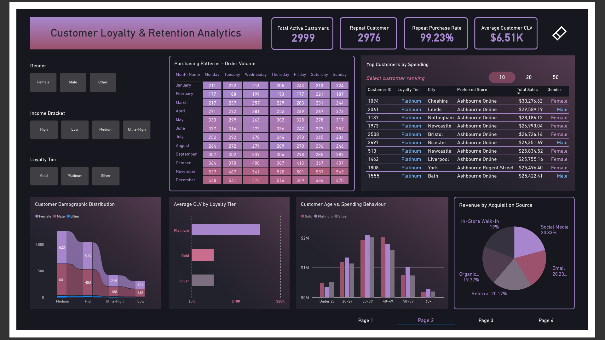
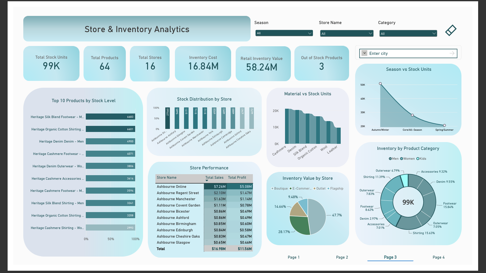
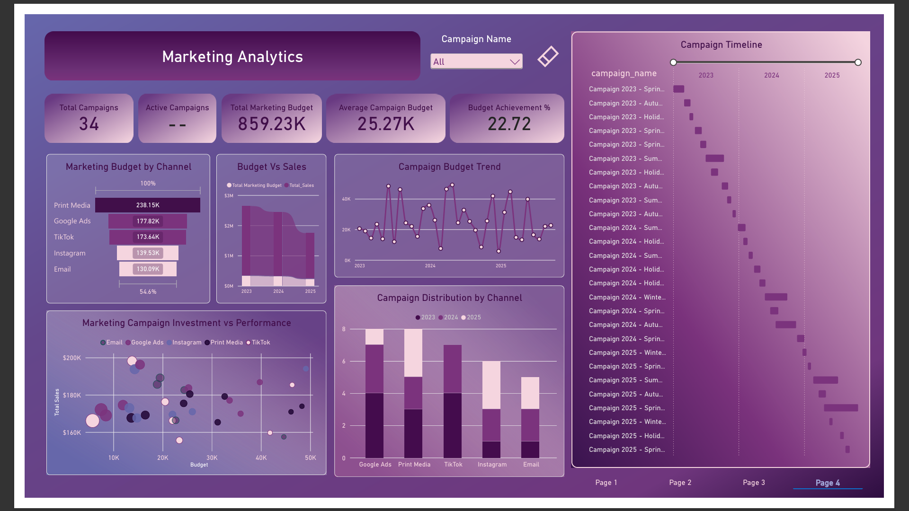

# Ashbourne & Co. – Retail Business Intelligence Dashboard

**A Comprehensive Retail Analytics & Business Intelligence Project**

## 1. Project Overview

Ashbourne & Co. is a retail business intelligence project developed using Microsoft Power BI to analyze business performance across sales, customers, inventory, stores and marketing activities.

The project transforms retail business data into interactive dashboards, enabling stakeholders to monitor key performance indicators (KPIs), identify trends, understand customer behavior and evaluate operational and marketing performance.

The project currently consists of four dashboard modules, with further analysis using Python, SQL and statistical methods planned as future extensions.

## 2. Business Objectives

The primary objectives of this project are to:

- Monitor overall retail sales, revenue and profitability.
- Evaluate sales performance across different time periods and store locations.
- Understand customer demographics, purchasing behavior and loyalty performance.
- Analyze customer lifetime value (CLV) and repeat purchasing patterns.
- Monitor inventory levels, stock distribution and inventory valuation.
- Evaluate marketing campaign investments and performance.
- Identify business trends and opportunities through data visualization.

## 3. Tools & Technologies

| Tool | Application |
|---|---|
| Microsoft Power BI | Interactive dashboards and reporting |
| Power Query | Data cleaning and transformation |
| DAX | KPI calculations and analytical measures |
| Data Modeling | Relationships between business tables |
| Microsoft Excel | Data preparation and source data handling |

## 4. Dashboard Modules

### 01. Executive Dashboard – Business Overview

**Objective:** Provide an integrated overview of retail business performance and support executive-level decision-making.

**Key Performance Indicators:**
- Total Sales
- Total Profit
- Total Orders
- Average Order Value (AOV)
- Profit Margin
- Profit per Order
- Return Rate

**Visualizations:**
- Revenue Trend
- Gross Sales to Net Profit Bridge
- Sales by Geography
- Top Market Performance
- Profit Composition
- Store Performance Analysis
- Sales and Profit Analysis

**Business Questions:**
- How is overall revenue and profitability performing?
- How do sales and profit change over time?
- Which geographical markets contribute to sales?
- How does store type and location relate to profitability?
- What is the relationship between sales, orders and average order value?

### 02. Customer Dashboard – Loyalty & Retention Analytics

**Objective:** Understand customer characteristics, purchasing patterns, loyalty performance and customer lifetime value.

**Key Performance Indicators:**
- Total Active Customers
- Average Customer Lifetime Value (CLV)
- Repeat Customers
- Repeat Purchase Rate

**Visualizations:**
- Revenue by Acquisition Source
- Average CLV by Loyalty Tier
- Customer Demographic Distribution
- Customer Age vs. Spending Behaviour
- Purchasing Patterns – Order Volume
- Top Customers by Spending
- Customer Loyalty and Retention Analysis

**Business Questions:**
- Which acquisition sources contribute to customer revenue?
- Which loyalty tier has the highest average CLV?
- How do customer demographics vary?
- How does customer age relate to spending behavior?
- When do customers place the most orders?
- How important are repeat customers to customer retention?

### 03. Store & Inventory Dashboard

**Objective:** Evaluate inventory availability, stock distribution, product performance and store-level inventory value.

**Key Performance Indicators:**
- Total Stores
- Total Products
- Total Stock Units
- Retail Inventory Value
- Inventory Value (Cost)
- Out of Stock Products

**Visualizations:**
- Store Performance
- Material vs. Stock Units
- Top 10 Products by Stock Level
- Stock Distribution by Store
- Inventory Value by Store
- Category and Subcategory Stock Distribution
- Season vs. Stock Units

**Business Questions:**
- How is inventory distributed across stores?
- Which products have the highest stock levels?
- How does inventory value vary across store types?
- Which product categories contribute to inventory?
- How does stock distribution vary by season?
- Are there products with zero stock availability?

### 04. Marketing Dashboard – Marketing Analytics

**Objective:** Analyze marketing campaign investments, campaign performance and budget allocation across different marketing channels.

**Key Performance Indicators:**
- Total Campaigns
- Active Campaigns
- Total Marketing Budget
- Average Campaign Budget
- Budget Achievement %

**Visualizations:**
- Marketing Campaign Investment vs. Performance
- Campaign Timeline
- Campaign Budget Trend
- Campaign Distribution by Channel
- Marketing Budget by Channel
- Budget vs. Sales

**Business Questions:**
- Which marketing channels receive the highest budget allocation?
- How does campaign investment relate to sales performance?
- Which campaigns generate stronger returns on investment?
- How does marketing budget change over time?
- How are campaigns distributed across different channels?
- How effectively are marketing budgets being utilized?

## 5. Key DAX Measures

The report includes analytical measures such as:

| Measure | Purpose |
|---|---|
| Total Sales | Calculates overall sales value |
| Total Profit | Calculates overall business profit |
| Total Orders | Measures order volume |
| Average Order Value | Measures average sales value per order |
| Profit Margin | Evaluates profitability relative to sales |
| Profit per Order | Measures average profit per order |
| Return Rate | Monitors product returns |
| Average Customer CLV | Measures average customer lifetime value |
| Repeat Purchase Rate | Evaluates customer repeat purchasing |
| Total Active Customers | Measures active customer base |
| Total Stock Units | Measures available inventory units |
| Inventory Value (Cost) | Measures inventory value at cost |
| Campaign ROI | Evaluates marketing campaign returns |
| Budget Achievement % | Measures marketing budget achievement |

## 6. Data Analysis & Interactivity

The dashboards include interactive reporting features to support business exploration:

- Slicers for dates, cities and store types.
- Customer filters for loyalty tiers, gender and income brackets.
- Product filters for categories, subcategories and seasons.
- Campaign selection and marketing channel analysis.
- Cross-filtering between relevant visualizations.
- KPI cards and comparative charts for performance monitoring.

These features allow users to explore different business dimensions and examine performance under different filter selections.

## 7. Key Analytical Focus & Business Insights

The project is designed to investigate several important business areas:

**Sales & Profitability**
- Revenue trends and profit contribution.
- Geographical and store-level sales performance.
- Relationship between sales volume and profitability.

**Customer Analytics**
- Differences in customer lifetime value across loyalty tiers.
- Customer acquisition source performance.
- Demographic and purchasing behavior patterns.
- Repeat purchase and retention performance.

**Inventory Analytics**
- Stock distribution across stores and categories.
- Inventory valuation and product availability.
- Seasonal inventory patterns.

**Marketing Analytics**
- Marketing investment across acquisition channels.
- Campaign ROI and budget performance.
- Relationship between campaign investment and sales.

*Specific numerical findings and recommendations will be documented after validating the analytical results.*

## 8. Project Repository Structure

```text
Ashbourne-Retail-Business-Intelligence/
│
├── README.md
│
├── 01-Power-BI/
│   ├── README.md
│   ├── Ashbourne_Retail_Analytics.pbix
│   ├── Ashbourne_Retail_Dashboard.pdf
│   └── Screenshots/
│       ├── 01-Executive-Dashboard.png
│       ├── 02-Customer-Analytics.png
│       ├── 03-Store-Inventory.png
│       └── 04-Marketing-Analytics.png
│
├── 02-Python/
│   └── README.md
│
├── 03-SQL/
│   └── README.md
│
├── 04-Statistical-Analysis/
│   └── README.md
│
└── 05-Data/
    └── README.md
```

## 9. Future Project Enhancements

This project is an ongoing analytical portfolio project. The following components will be added:

- **Python:** Data cleaning, exploratory data analysis (EDA), statistical visualization and business insights.
- **SQL:** Business-focused queries, joins, aggregations, CTEs and window functions.
- **Statistical Analysis:** Descriptive statistics, correlation analysis and hypothesis testing.
- **Interactive Web Dashboard:** A browser-based interactive version of the Power BI dashboards.

## 10. Project Status

| Component | Status |
|---|---|
| Power BI Dashboard Development | Developed |
| Power BI Documentation | In Progress |
| Python Analysis | Planned |
| SQL Analysis | Planned |
| Statistical Analysis | Planned |
| Interactive Web Dashboard | Planned |

---

**Project:** Ashbourne & Co. – Retail Business Intelligence  
**Focus:** Business Analytics | Data Analytics | Business Intelligence  
**Tools:** Power BI | DAX | Power Query | Excel

*This project demonstrates the application of business intelligence and analytical techniques to retail business performance and decision-making.*


## 📊 Dashboard Previews

### 1. Executive Dashboard


### 2. Customer Analytics Dashboard


### 3. Store Analytics Dashboard


### 4. Marketing Analytics Dashboard


